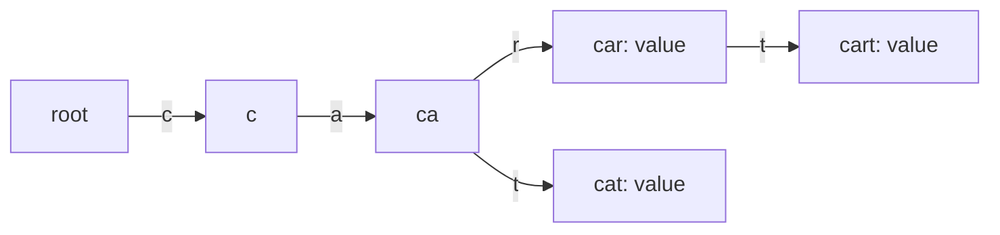

# Trie Map

`TrieMap<V>` stores one child transition per Unicode code point. A path spells a key; a node may
hold a value independently from having children.

The root may store the empty-string value. Prefix lookup follows one code point at a time, and
ordered enumeration traverses child keys in code-point order. Operations over a key of `m` code
points are expected `O(m)` before output enumeration; storage is proportional to retained nodes and
edges.

**Implementation guide:** distinguish “node has value” from a stored `undefined`, prune only
valueless childless nodes after deletion, preserve shared prefixes, and build returned key strings
without changing caller input. Source is `trie-map.ts`; shared behavior is in `../trie.test.ts`.
